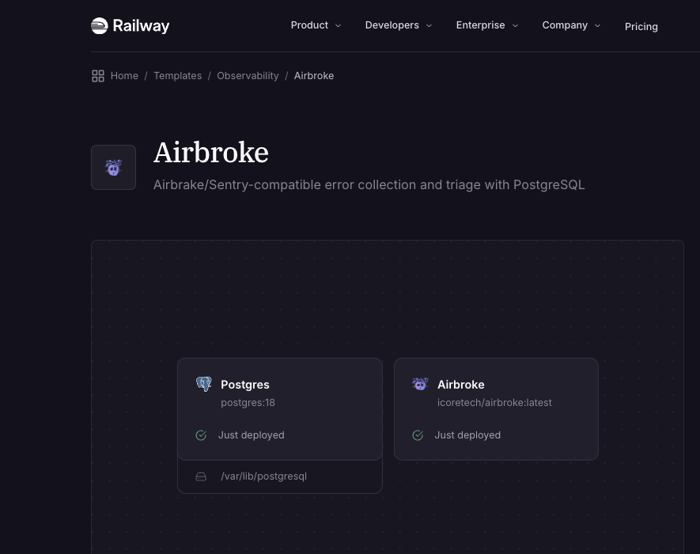
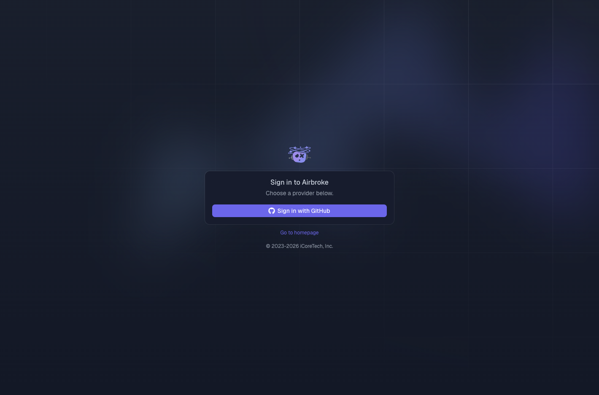
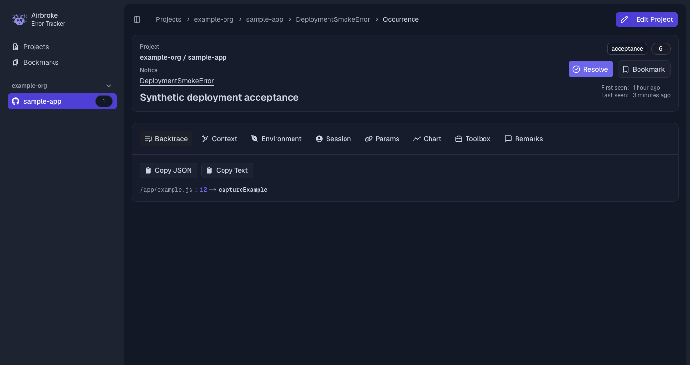

# Deploy Airbroke on Railway

Run your own error collector and triage dashboard with Airbroke and PostgreSQL.
The template uses the published `ghcr.io/icoretech/airbroke:latest` stable image,
a private PostgreSQL 18 service, and persistent database storage. No source
build, Redis, worker service, or application volume is required.
This setup requires Airbroke 1.4.3 or newer.



## Before deployment

You need a Railway account and at least one GitHub organization whose members
may access this installation. Create the GitHub OAuth application after Railway
assigns your public domain. All authenticated users can access every Airbroke
project: organization names inside Airbroke do not establish separate access
boundaries.

## Deploy and sign in

1. Open the [Airbroke Railway template](https://railway.com/deploy/airbroke?referralCode=ftyt7p&utm_medium=integration&utm_source=template&utm_campaign=generic) and choose your workspace and region.
2. Enter a nonempty `AIRBROKE_GITHUB_ORGS` allowlist. Use exact GitHub organization
   login names, separated by commas, such as `example-org`. Leave
   `AIRBROKE_GITHUB_ID` and `AIRBROKE_GITHUB_SECRET` empty for this initial deploy.
3. Deploy both services. Database migrations run before Airbroke starts; Railway
   waits for `/api/hc` to return HTTP 200 before activating the deployment.
4. Create a [GitHub OAuth application](https://docs.github.com/en/apps/oauth-apps/building-oauth-apps/creating-an-oauth-app)
   using the generated Airbroke HTTPS origin as its homepage and that origin
   followed by `/api/auth/callback/github` as its authorization callback URL.
   Confirm `BETTER_AUTH_URL` resolves to the same origin.
5. Set `AIRBROKE_GITHUB_ID` and `AIRBROKE_GITHUB_SECRET` in the Airbroke service's
   variables to the OAuth application's real client ID and secret, then deploy
   those variable changes.
6. Visit `/signin`, choose GitHub, and sign in as a member of an allowed
   organization. Create a project and use its setup instructions to configure
   your Airbrake or Sentry client.

GitHub sign-in is unavailable until both OAuth credentials are configured.



Airbroke requests `read:org` to check organization membership; if your
organization restricts OAuth applications, its owner must approve access.
There is no default password, bootstrap administrator, or password sign-up.
Keep the organization allowlist configured: leaving it empty removes that
restriction. When changing to a custom domain, update `BETTER_AUTH_URL` and the
GitHub callback together, then redeploy.

## Services and variables

| Service | Configuration |
| --- | --- |
| Airbroke | `ghcr.io/icoretech/airbroke:latest`; public HTTPS domain targeting port `3000`; no persistent volume |
| PostgreSQL | PostgreSQL 18; persistent volume at `/var/lib/postgresql`; private networking only, with no public TCP proxy |

The application retains the image's start command, `dumb-init node server.js`,
which runs from `/app` as UID 1001. Set the application's pre-deploy command to:

```sh
sh -c "cd /app/migrations-runtime && node_modules/.bin/prisma migrate deploy"
```

Keep the explicit `sh -c`: the command needs a shell for `cd` and `&&`.
The pre-deploy process uses the same private database as the application. A
migration failure must stop the deployment. Do not move migrations into a
background process or replace the command with `yarn db:migrate`: the production
image carries a separate, self-contained migration runtime.

| Application variable | Value |
| --- | --- |
| `HOSTNAME` | `0.0.0.0` |
| `PORT` | `3000` |
| `AIRBROKE_AUTH_IP_HEADERS` | `x-real-ip`, supplied by Railway public HTTP ingress |
| `DATABASE_URL` | Reference to the PostgreSQL service's private connection URL |
| `DIRECT_URL` | The same private connection URL; alternatively omit this variable entirely |
| `BETTER_AUTH_URL` | `https://${{RAILWAY_PUBLIC_DOMAIN}}`, or your custom HTTPS origin |
| `BETTER_AUTH_SECRET` | Independently generated persistent secret |
| `NEXT_SERVER_ACTIONS_ENCRYPTION_KEY` | Independently generated, base64-encoded 32-byte AES key |
| `AIRBROKE_GITHUB_ID` | Empty for initial deployment; set the OAuth application's client ID before sign-in |
| `AIRBROKE_GITHUB_SECRET` | Empty for initial deployment; set the OAuth application's client secret before sign-in |
| `AIRBROKE_GITHUB_ORGS` | Required nonempty comma-separated organization allowlist |

Do not set `DIRECT_URL` to an empty string: it prevents migration configuration
from falling back to `DATABASE_URL`. Keep database references private and point
both URLs at the same database.

Railway public HTTP ingress overwrites `X-Real-IP`; the template uses that
single address for authentication rate limiting and session tracking. Keep
authentication traffic behind that ingress. Private network callers bypass
this header sanitation, so do not expose the auth routes to untrusted services
over private networking. For a different ingress, verify its header contract
before carrying this setting over; do not trust a caller-controlled header or
invent proxy address ranges.

The template generates secrets independently for each installation. In the
Railway composer, use `${{secret(64)}}` for `BETTER_AUTH_SECRET`. For the Next.js
key, use the following [template variable expression](https://docs.railway.com/templates/create#template-variable-functions):

```text
${{secret(43, "abcdefghijklmnopqrstuvwxyzABCDEFGHIJKLMNOPQRSTUVWXYZ0123456789+/")}}=
```

For manual setup, `openssl rand -base64 32` generates a suitable Next.js key.
This is an encoded encryption key, not encrypted text. Preserve both application
secrets across redeploys and use the same values on every application replica.

`AIRBROKE_CORS_ORIGINS` optionally limits browser origins calling the collector
endpoints. Set it to the origins of applications sending browser errors, not
just the Airbroke dashboard origin. If omitted, collector CORS allows all
origins. AI assistance and the MCP endpoint are optional; configure their
credentials separately using the [environment reference](https://github.com/icoretech/airbroke/blob/main/.env.dist).

## Verify the installation

Check the migration result in the deployment logs and visit `/api/hc` on your
public domain. This endpoint queries PostgreSQL; HTTP 200 confirms the
application can read its project table. It does not verify OAuth configuration
or collector ingestion.

Complete a real GitHub sign-in, create a project, send a test error using its
setup guide, and confirm the occurrence appears. Then redeploy the same image
and confirm the project and occurrence remain. Railway's deployment healthcheck
is an activation check; configure independent monitoring for ongoing uptime.



The example uses synthetic error data. Screenshots show the template preview,
configured sign-in page, and occurrence view; account details are outside the
captured regions.

## Updates and backups

New installations use `latest`. For an existing installation, back up PostgreSQL,
review the [release notes](https://github.com/icoretech/airbroke/releases), and
redeploy from the image source to fetch the current image. With the Railway CLI
linked to the intended project, environment, and Airbroke service:

```sh
railway redeploy --from-source
```

An ordinary redeploy reuses the previous deployment's source. You can instead
select an exact release tag for a controlled upgrade, or opt into Railway's
[image auto updates](https://docs.railway.com/deployments/image-auto-updates)
with an appropriate maintenance window. Configure database backups separately:
the database volume belongs to PostgreSQL, not the Airbroke service.

PostgreSQL holds projects, occurrences and their payloads, sessions, OAuth
tokens, and integration credentials. Protect database access and backups, and
keep a secure copy of the application secrets. Rolling back the application
image does not reverse migrations or restore database contents; use a
schema-compatible image or a tested database restore procedure.

## Maintaining the template

The saved Railway template composer configuration is authoritative. This
directory contains the deployment guide and [marketplace overview](marketplace.md),
not a second template manifest. Template edits do not update existing
installations.

When changing the deployment contract, update the composer and these documents,
then test a fresh deployment from the saved template. Verify private database
references, persistent storage, generated secrets, migration failure gating,
healthchecks, sign-in, ingestion, and data persistence before publishing.
Use the actual public share URL returned by Railway when updating deploy links.

Platform references: [templates](https://docs.railway.com/templates/create),
[public ingress headers](https://docs.railway.com/networking/public-networking/specs-and-limits),
[pre-deploy commands](https://docs.railway.com/deployments/pre-deploy-command),
[healthchecks](https://docs.railway.com/deployments/healthchecks), and
[redeploy from source](https://docs.railway.com/cli/redeploy).
